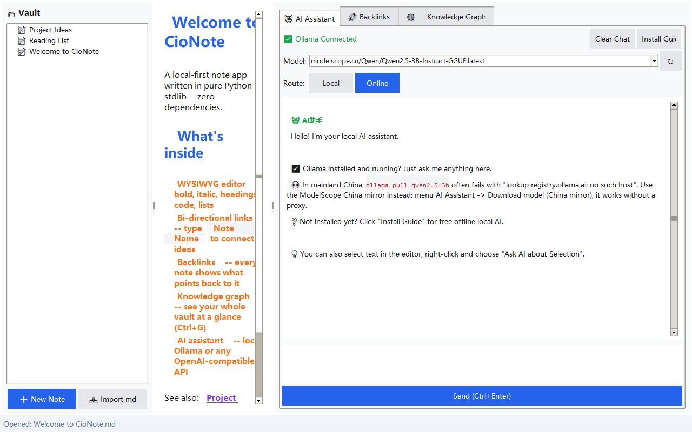

<p align="center"></p>

# 📝 CioNote —— 本地笔记 + AI 助手

**[English](README.md)** | 简体中文

一个用 Python 标准库（tkinter）写的轻量笔记工具，风格接近 Obsidian：
编辑/预览一体、双向链接、反向链接、知识图谱，右侧自带 AI 助手聊天面板（本地 Ollama 或任意 OpenAI 兼容接口）。

**纯标准库、零第三方依赖**；笔记是普通 `.md` 文件，数据永远在你自己电脑上。



## ✨ 特性

- 📝 所见即所得 Markdown 编辑
- 🔗 双向链接 `[[笔记名]]`，`Ctrl+Click` 跳转；🔙 反向链接面板
- 🕸 知识图谱可视化（Ctrl+G）
- 🤖 内置 AI 助手：本地 Ollama（离线私密）或在线 API（DeepSeek / 智谱 / 硅基流动 / OpenAI）
- 🔒 隐私优先：API Key 用 Windows DPAPI 加密存储，绝不明文落盘
- 📦 零依赖，装好 Python 就能跑；🌍 中英双语界面

## 🚀 快速开始

1. 安装 [Python 3.8+](https://www.python.org/downloads/)（**务必勾选 Add Python to PATH**）
2. 双击 **`Launch CioNote.bat`**（启动器自动找解释器 + 探测 Ollama，日志在 `launcher.log`）
3. 菜单 **File → Open Vault** 选一个文件夹当笔记库，开始记笔记

启动没反应 → 双击 **`DEBUG-Launcher.bat`** 看完整错误。

## 🤖 AI 助手

**方式 A：本地免费 —— Ollama + 国内源**

国内直连 `registry.ollama.ai` 常报 `no such host`，改用魔搭国内源：

```
ollama run modelscope.cn/Qwen/Qwen2.5-3B-Instruct-GGUF
```

或双击 **`Download-Model-ChinaMirror.bat`** / 菜单 **AI 助手 → 下载模型（国内源）**。
下载完（约 2GB）回程序点 **检测Ollama连接**，模型自动出现在下拉框。

> **开聊前看「路由」**：必须选中 **💻 本地**，消息才会发给 Ollama。

**方式 B：在线接口** —— 菜单 **AI 助手 → 在线API设置**，Backend 选 `openai`，
填 Base URL + API Key 即可（本程序**不内置任何 Key**，需要自己申请，多数有免费额度）。

| 服务 | Base URL | 模型示例 |
|---|---|---|
| DeepSeek | `https://api.deepseek.com/v1` | `deepseek-chat` |
| 智谱 GLM | `https://open.bigmodel.cn/api/paas/v4` | `glm-4-flash` |
| 硅基流动 | `https://api.siliconflow.cn/v1` | `Qwen/Qwen2.5-7B-Instruct` |
| OpenAI | `https://api.openai.com/v1` | `gpt-4o-mini` |

## ⌨️ 快捷键

`Ctrl+O` 打开库 · `Ctrl+N` 新建 · `Ctrl+S` 保存 · `Ctrl+P` 快速切换 ·
`Ctrl+B`/`Ctrl+I` 加粗斜体 · `` Ctrl+` `` 插入双链 · `Ctrl+G` 知识图谱 ·
`Ctrl+E` AI 助手 · `Ctrl+Enter` 发送消息

## 🔧 排障

- 启动不起来 → `launcher.log`
- AI 聊不起来 → `~/.cionote_ai.log`（含真实失败原因）
- exit code 9009 → `python` 是微软商店占位符，装真 Python 并勾 PATH + tcl/tk

## 📄 许可证

[MIT](LICENSE) © 2026 [CioGe](https://github.com/CioGe) —— 可自由使用、修改、分发（含商用），只需保留版权声明。

<details>
<summary>MIT 条款中文译文（仅供参考，不具法律效力，以英文原文为准）</summary>

特此免费授予任何获得本软件及相关文档副本的人，不受限制地处理本软件的权利，包括但不限于使用、复制、修改、合并、发布、分发、再许可和/或销售本软件副本的权利，但须满足以下条件：

上述版权声明和本许可声明应包含在本软件的所有副本或重要组成部分中。

本软件按"现状"提供，不提供任何明示或默示的担保，包括但不限于适销性、特定用途适用性和非侵权性的担保。在任何情况下，作者或版权持有人均不对因本软件或本软件的使用或其他交易而产生的任何索赔、损害或其他责任负责。

</details>

## ™️ 商标声明

**Obsidian** 是 Dynalist Inc. 的注册商标。**CioNote** 是独立开源项目，与 Obsidian 及 Dynalist Inc. **不存在任何关联、授权、背书或赞助关系**。

- CioNote 不含任何 Obsidian 的源代码、资源或品牌资产，全部基于 Python 标准库从零编写；
- 它只是读写文件夹里的普通 Markdown `.md` 文件，采用的是整个笔记软件品类共通的工作流；
- 本项目文档中出现 "Obsidian" 字样仅为描述性比较（指示性合理使用），不代表任何隶属关系。

文档中出现的第三方商标（Obsidian、魔搭 ModelScope、DeepSeek、智谱 GLM、硅基流动、OpenAI、Ollama）归各自权利人所有，此处仅为说明兼容性而引用。

## ⭐ 支持一下

如果 CioNote 对你有用，点个 **Star** ⭐ 让更多人看到；欢迎转发、写文章、提 Issue 和 PR！
